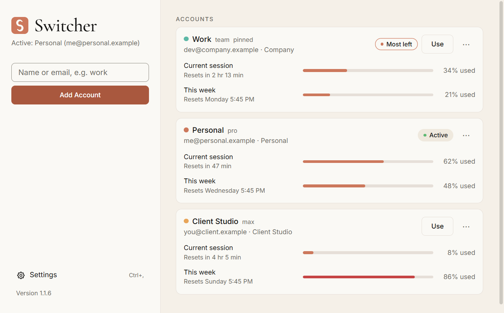

<div align="center">

<picture>
  <source media="(prefers-color-scheme: dark)" srcset="docs/logo/glass-dark.png">
  
</picture>

# Switcher

**One click between Claude Code accounts.**<br>
See every account's session and weekly usage, and keep a 5-hour window running on all of them.

[](https://github.com/Harshul1484/switcher/actions/workflows/release.yml)
[](#install)
[](LICENSE)

<br>

<picture>
  <source media="(prefers-color-scheme: dark)" srcset="docs/screenshots/switcher-dark.png">
  
</picture>

<br><br>

### Download

[](https://github.com/Harshul1484/switcher/releases/latest/download/Switcher-Setup.exe)
[](https://github.com/Harshul1484/switcher/releases/latest/download/Switcher-arm64.dmg)
[](https://github.com/Harshul1484/switcher/releases/latest/download/Switcher-x64.dmg)

[](https://github.com/Harshul1484/switcher/releases/latest/download/switcher_amd64.deb)
[](https://github.com/Harshul1484/switcher/releases/latest/download/switcher.pacman)
[](https://github.com/Harshul1484/switcher/releases/latest/download/switcher.x86_64.rpm)
[](https://github.com/Harshul1484/switcher/releases/latest/download/Switcher-x86_64.AppImage)

<sub>Unofficial. Not affiliated with or endorsed by Anthropic. Requires the <a href="https://docs.anthropic.com/en/docs/claude-code">Claude Code</a> CLI.</sub>

</div>

<br>

## Features

- **One-click switching.** Save each account once; **Use** makes it the one Claude Code runs as. Only the login changes; your settings, MCP servers and project history stay put.
- **Usage at a glance.** Every account shows its current-session and weekly usage, with live reset countdowns.
- **Session manager.** Optionally keeps a 5-hour session window running on every account that still has weekly limit left, so the clock is already ticking when you need it.
- **Quick switcher.** Press <kbd>Ctrl</kbd>+<kbd>Shift</kbd>+<kbd>Alt</kbd>+<kbd>S</kbd> (<kbd>⌘</kbd>+<kbd>Shift</kbd>+<kbd>Option</kbd>+<kbd>S</kbd> on macOS) anywhere, type, press Enter. The shortcut is configurable in Settings.
- **Lives in the tray.** Closing the window keeps Switcher in the system tray (menu bar on macOS), where you can switch accounts too. Optionally starts when you log in.
- **Notifications.** A heads-up when an account reaches 80% of its weekly limit, runs out, or gets its session back, and when a login expires.
- **Most left.** The account with the most usage left is marked, so you know which one to switch to.
- **Yours to arrange.** Rename accounts, give them a colour, pin them to the top, and drag to reorder.
- **Safe by design.** Credentials are backed up before every switch, never leave your machine except to Anthropic, and are never logged.
- **Updates itself.** New versions download in the background; one click installs them.

## Install

<details>
<summary><b>Windows</b></summary>

Run `Switcher-Setup.exe`. It installs for your user only, no admin rights needed. The installer isn't code-signed, so SmartScreen may warn: choose **More info → Run anyway**.
</details>

<details>
<summary><b>macOS</b></summary>

Open the `.dmg` for your Mac (**Apple Silicon** for M-series chips, **Intel** otherwise) and drag Switcher to Applications. The app isn't notarized by Apple, so the first launch needs one approval: **System Settings → Privacy & Security → Open Anyway**, or run

```sh
xattr -dr com.apple.quarantine /Applications/Switcher.app
```

On macOS, the **Update** button opens the download page, because macOS only lets apps signed with an Apple Developer ID update themselves.
</details>

<details>
<summary><b>Linux</b></summary>

| Distribution | Install |
|---|---|
| Ubuntu, Debian, Kali, Mint, Pop!_OS | `sudo apt install ./switcher_amd64.deb` |
| Arch, Manjaro, EndeavourOS | `sudo pacman -U switcher.pacman` |
| Fedora, RHEL, openSUSE | `sudo dnf install ./switcher.x86_64.rpm` |
| Anything else | `chmod +x Switcher-x86_64.AppImage && ./Switcher-x86_64.AppImage` |

On Ubuntu 24.04 and later, prefer the `.deb`: AppArmor can stop AppImages from starting. If your terminal app isn't one Switcher knows, **Add Account** shows the sign-in command to run yourself.
</details>

You also need the [Claude Code](https://docs.anthropic.com/en/docs/claude-code) CLI: `claude` should work in a terminal.

## Using it

1. **Add Account**: type a name (an email works). A terminal opens running `claude auth login` in an isolated profile; sign in there.
2. **Use**: makes that account the one Claude Code runs as. In VS Code, run **Developer: Reload Window** so the extension picks it up.
3. **Session manager**: open **Settings** (bottom left, or <kbd>Ctrl</kbd>+<kbd>,</kbd>), turn on *Keep a 5-hour session running*, and choose the starting message it sends (with Haiku, no tools) to accounts that have no window running.

If a card can't load usage, **Reconnect** retries, or reopens sign-in when the login has expired. Each card's **⋯** menu renames, pins, colours, moves or removes the account.

**Settings** also has start at login (installed app only), notifications, and the quick switcher shortcut: click the field and press the new combination, or **Turn off**.

## How it works

- Each account lives in `~/.claude-profiles/<name>/`, with its own `.credentials.json` and `.claude.json`.
- Switching replaces only the login (`claudeAiOauth` in `~/.claude/.credentials.json`, or the `Claude Code-credentials` Keychain item on macOS) and the account info (`oauthAccount` in `~/.claude.json`).
- Credentials are backed up to `~/.claude-profiles/.backups/` before every switch.
- Usage comes from Anthropic, using each account's own token, at most every 10 minutes per account. Switcher remembers the last answer, and backs off when Anthropic asks it to.

## Privacy

Switcher talks only to Anthropic (`api.anthropic.com` for usage, `platform.claude.com` to refresh an inactive account's login) and to GitHub for updates. No telemetry, no analytics, no third parties. It never refreshes the login Claude Code is currently using.

## Contributing

Contributions are welcome. Read [CONTRIBUTING.md](CONTRIBUTING.md) first: every pull request is reviewed by the maintainer before it's merged, and merging into `main` ships a release. Please also follow the [Code of Conduct](CODE_OF_CONDUCT.md).

| | |
|---|---|
| [CONTRIBUTING.md](CONTRIBUTING.md) | How to contribute, and the rules for pull requests |
| [DESIGN.md](DESIGN.md) | The design system: colours, type, components |
| [AGENTS.md](AGENTS.md) | Guide for AI coding agents working on this repo |
| [SECURITY.md](SECURITY.md) | How to report a vulnerability privately |

## Development

```sh
npm install
npm start      # run the app
npm test       # core tests (fake home dir, fake network)
npm run dist   # build installers for your system into dist/
```

Pushes to any branch build and test on Windows, macOS and Linux ([ci.yml](.github/workflows/ci.yml)). Every push to `main` is tested, tagged with the next version, and released for all three systems once every build succeeds ([release.yml](.github/workflows/release.yml)).

## Caveats

- Built against Claude Code 2.1.332. It relies on Claude Code's file formats and undocumented endpoints, which can change.
- Used day to day on Windows. Linux passes the full test suite in CI; the macOS Keychain switching isn't covered by automated tests yet.
- Use it with your own accounts and within Anthropic's terms.

## License

[MIT](LICENSE)
